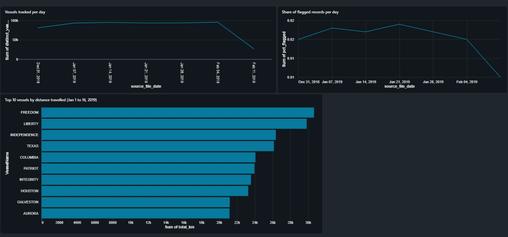

# Vessel Intelligence Pipeline: AIS Data on Azure Databricks


A data pipeline that processes NOAA AIS vessel tracking data on Azure Databricks, using the medallion architecture (raw, Bronze, Silver, Gold) with Delta Lake.




## Architecture

```
NOAA zip files → raw → Bronze (Delta) → Silver (Delta) → Gold (Delta) → Dashboard
```

| Layer | Contents |
|---|---|
| Raw | NOAA zip files, stored unchanged |
| Bronze | All values as strings, audit columns, partitioned by date |
| Silver | Typed columns, duplicates removed, conflicts flagged, validation status |
| Gold | Distance per vessel per day, daily fleet KPIs, vessel reference table |

## Results

- Pipeline runs weekly and adds up to 7 new days per run
- Loaded data from January 1, 2019 onward, with new days added each week
- 287,590,182 raw position records in Bronze as of the latest verified run
- `[SILVER_TOTAL]` rows in Silver after validation
- `[VESSEL_DAYS]` vessel-days in Gold
- `[NAMED_VESSELS]` named vessels in the reference table
- Counts are from the latest verified run and grow as the job continues

  
## Design decisions

- **Conflicts are flagged, not dropped.** When two positions share a vessel ID and timestamp, the pipeline can't tell which is correct, so both are kept and marked with `key_conflict`.
- **Sentinel values are nulled.** Speed 102.3 and heading 511 mean "not available" in AIS, so they become null instead of marking the row as an error.
- **Implausible movement is filtered.** Legs faster than 100 km/h are excluded from distance metrics. Without this filter, one vessel showed 2.88 million km in a single day.
- **Writes are per day.** Each day is replaced by its own write, so reruns don't duplicate data and a failure only affects one day.
- **Secrets are stored in a secret scope,** not in notebooks.

## Schedule

The pipeline runs weekly on Sunday and loads up to 7 new days per run. Each run finds the days not yet loaded, so the dataset grows over time without reprocessing old data.

## Project structure

```
notebooks/
├── 00_raw_fetch.py          Download NOAA zips to the raw container
├── 01_bronze_ingest.py      Unzip and load into the Bronze Delta table
├── 03_silver_layer.py       Clean, type, and validate into Silver
└── 04_gold_layer.py         Build the Gold tables for analysis
docs/
└── dashboard.png
```

## Tech stack

Azure Databricks, Apache Spark (PySpark), Delta Lake, Azure Blob Storage, Databricks Workflows, Databricks SQL dashboards
